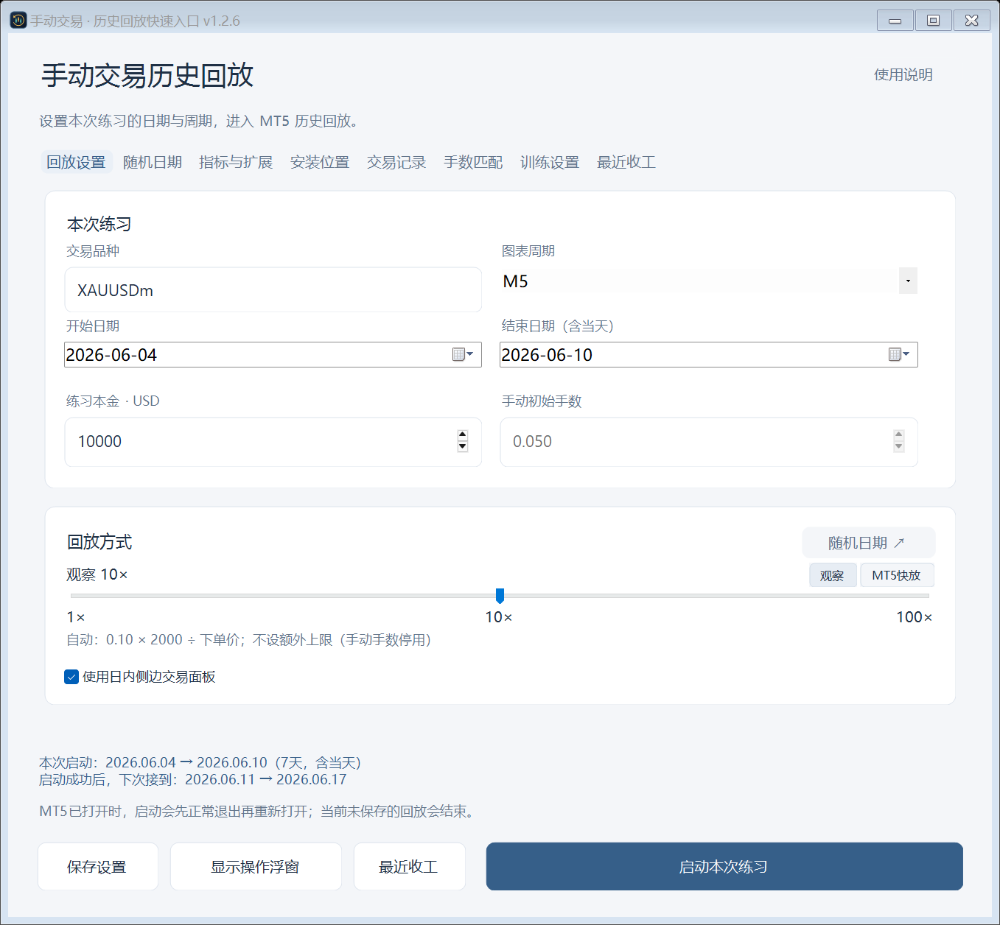
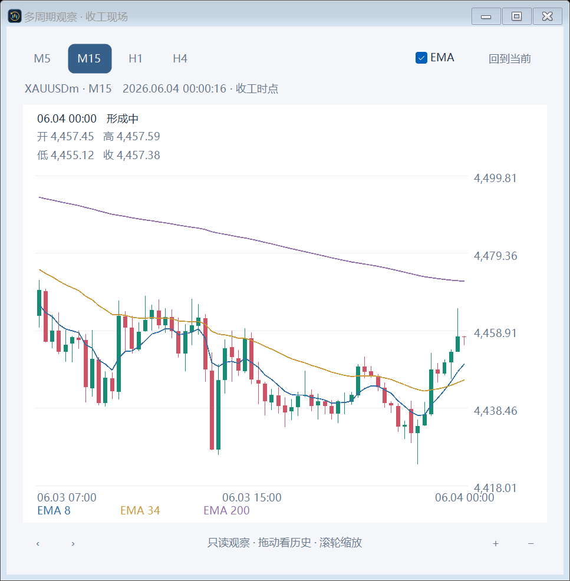
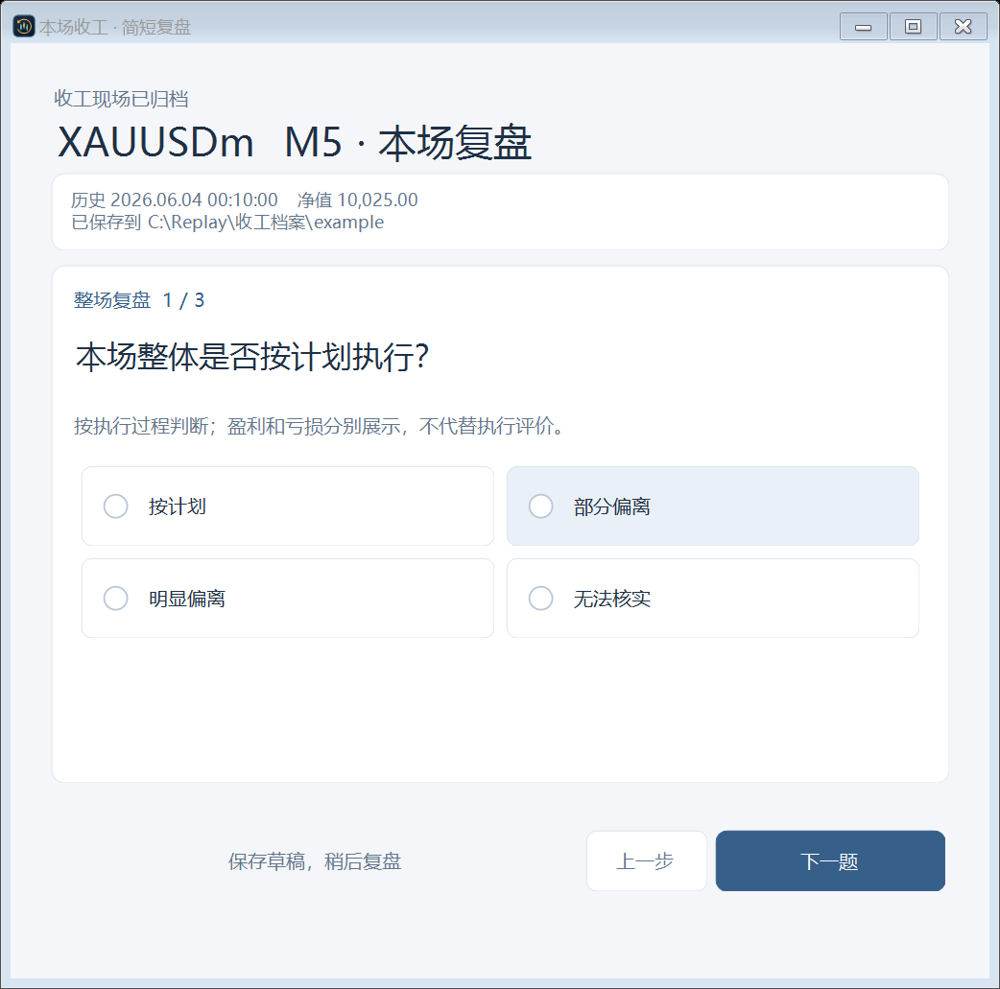

# MT5 手动历史回放

基于 MetaTrader 5 策略测试器的手动交易练习工具。用历史行情写计划、手动交易，收工时保存当时的现场，再完成简短复盘。

**v1.2.6 · Windows x64 · GPL-3.0-only · 首次公开测试版**

[下载程序和对应源码](https://raw.githubusercontent.com/zhenwang39derchef-prog/mt5-manual-replay/main/downloads/mt5-manual-replay-v1.2.6-windows-x64.zip) · [仅下载源码](https://raw.githubusercontent.com/zhenwang39derchef-prog/mt5-manual-replay/main/downloads/mt5-manual-replay-v1.2.6-source.zip) · [SHA-256校验值](https://github.com/zhenwang39derchef-prog/mt5-manual-replay/blob/main/downloads/SHA256SUMS.txt)



## 可以做什么

- 在可视化策略测试器中手动买卖、管理持仓与挂单、拖线修改止盈止损。
- 逐题填写交易计划，直接输入或粘贴价格。
- 在独立浅色观察窗切换 M5 / M15 / H1 / H4，显示 EMA8 / 34 / 200。
- 使用 1–100× 观察速度；快放使用 MT5 自带速度条。
- 收工时封存净值、持仓、挂单、完整计划、设置、交易记录及多周期图表。
- 依次完成三题整场复盘，逐笔复盘按需展开；稍后可从“最近收工”继续。
- 收工现场与测试最终结果分别保留，MT5退出后仍可离线查看封存图表。



## 先下载安装

点击上面的“下载程序和对应源码”，下载 `mt5-manual-replay-v1.2.6-windows-x64.zip`，解压整个文件夹到可写目录。运行 `手动回放快速入口v1.2.6.exe`，并保留旁边完整的 `assets` 文件夹。

环境需要 Windows x64、.NET Framework 4.x 运行环境，以及桌面版 MT5 和随附的 MetaEditor。MT5 和经纪商历史行情需自行准备。

### 第一次运行务必设置安装位置

1. 在入口的“安装位置”页选择自己的 `terminal64.exe`。
2. 在 MT5 中点“文件 → 打开数据文件夹”，把该目录填入入口的 MT5 数据文件夹栏。程序路径与数据目录必须属于同一个 MT5 安装。
3. 在“回放设置”中填写自己经纪商实际提供的品种名称，例如 `XAUUSD` 或 `XAUUSDm`，并选择可用的历史日期、周期与初始资金。建议勾选“使用日内侧边交易面板”。
4. 保存当前其他 MT5 工作后，再点击“启动本次练习”。入口会请求所选 MT5 安装正常退出并用本次测试配置重新启动；本次未保存的回放会结束。

**v1.2.6 的默认安装路径来自开发时的 Exness 环境，其他电脑需要手动修改。** 品种名称、报价精度、交易量步长与历史资料由经纪商决定；已完成的实机验收范围见 [已知限制](docs/KNOWN_LIMITATIONS.md)。

## 一次练习的流程

选择日期 → 启动回放 → 填写计划 → 手动交易 → 暂停或收工。

临时离开用“暂停”；本场完成用“收工”。确认收工后，程序等待测试器确认暂停并封存资料，显示成功回执，再进入三题整场复盘。本场随后仅用于复盘与退出。

收工时仍存在的持仓和挂单会留在原始现场中。测试器结束产生的最终结算单独保存，便于区分“决定停止时看到什么”和“测试最终如何结算”。



## 数据保存在本机

- 程序目录中的 `交易记录/`、`图表演练记录/`、`收工档案/` 保存本机资料。
- MT5 通用文件夹下的 `CN_Manual_Replay/` 保存回放会话和通信文件。
- `settings.json`、`last-session.json`、`practice-sequence.json` 会在使用中生成。

发布包不包含维护者的设置、账户资料、交易记录或收工档案。更新时先备份自己的这些目录和文件。

## 从源码构建

在 Windows 上使用 PowerShell 7，从仓库目录执行：

```powershell
.\Build.ps1
.\Test.ps1
```

`Build.ps1` 使用 Windows .NET Framework C# 编译器编译 `src/`，将程序与 `assets/` 放入 `dist/`。仓库附带经过验收的 EX5，首次构建桌面入口时可直接使用。

修改了 MQL5 源码时，先按 [构建说明](docs/BUILD.md) 使用自己的 MetaEditor 重编译原生文件，再构建桌面包。

## 验证与反馈

v1.2.6 在维护者环境中完成了 891 项原有自动、组件和原生检查，并补做正式版的多周期、窗口恢复、收工复盘退出及离线找回实机验收。开源仓库提供可独立运行的 49 项档案检查和 59 项多周期检查；完整 MT5 场景验收需要有历史行情的 MT5 安装。见 [验证范围](docs/VALIDATION.md)。

遇到问题请创建 Issue，写明 Windows/MT5 版本、经纪商品种名称、显示缩放、操作步骤和实际现象。上传截图或日志前，请去掉账户号、姓名和自己的交易记录。

## 许可与依赖

本项目按 [GNU GPL v3](LICENSE) 发布，标识为 `GPL-3.0-only`。分发修改版时，请依照该许可提供相应源码并保留许可声明。Windows、.NET、MetaTrader 和其标准库分别遵循各自条款，未随项目分发。参见 [第三方说明](THIRD_PARTY_NOTICES.md)。
